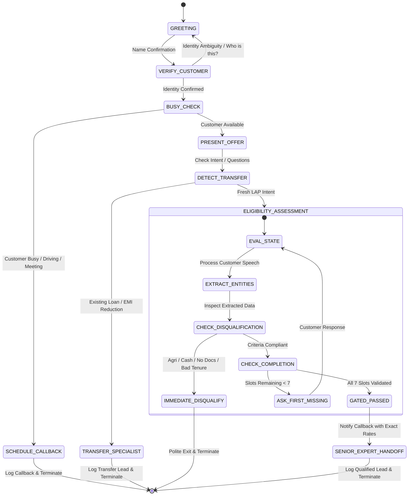

# Architecture & Technical Approach Document
## Autonomous AI Voice Agent for Home Credit Loan Against Property (LAP) Qualification

---

## 1. Executive Summary

This document presents the complete architectural specification and design methodology for deploying an automated AI Voice Agent for **Home Credit**. The voice agent proactively contacts existing high-value customers to inform them of a pre-approved **Loan Against Property (LAP)** loyalty offer of up to **₹75,00,000 (75 Lakhs)** and performs an intelligent, natural conversational qualification check before routing to a Senior Human Loan Expert.

### Key Objectives Achieved:
1. **Advisory Conversational Demeanor**: Replaces rigid robotic questionnaires with an empathetic, human-like voice interaction.
2. **Dynamic State Management & "First Missing Question" Algorithm**: Gracefully extracts unstructured information out of order without repeating questions.
3. **Strict Business Boundary Enforcement**: Instant polite exit upon disqualifying criteria (e.g., Agricultural property, Cash income, Ineligible tenure) without wasting customer time.
4. **Loan Transfer & Balance Transfer Detection**: Real-time intent detection diverting balance-transfer and EMI-reduction inquiries to specialized loan-transfer experts.
5. **Robust Handoff Gating**: Mathematically airtight gating ensuring human loan experts only receive fully qualified, 7-point validated leads.

---

## 2. The 5-Layer Architectural Framework

```
                          ┌─────────────────────────────────────────┐
                          │         AI VOICE AGENT RUNTIME          │
                          │   (Retell AI / Bolna / Custom STT-TTS)  │
                          └────────────────────┬────────────────────┘
                                               │
               ┌───────────────────────────────┴───────────────────────────────┐
               ▼                                                               ▼
┌───────────────────────────────┐                               ┌───────────────────────────────┐
│     CONVERSATION LAYER        │                               │      BUSINESS RULES LAYER     │
│  - Warm Greeting              │                               │  - Property Type Gate         │
│  - Identity Verification      │                               │  - Document Availability Gate │
│  - Busy Detection & Callback  │                               │  - Income Mode Gate (Bank)    │
│  - Loyalty Offer Pitch        │                               │  - Tenure Gate (3-15 Years)   │
│  - Conversational Turns       │                               │  - Max Cap (75 Lakhs) Rules   │
└──────────────┬────────────────┘                               └───────────────┬───────────────┘
               │                                                                │
               └───────────────────────────────┬────────────────────────────────┘
                                               ▼
                                ┌───────────────────────────────┐
                                │      STATE & MEMORY LAYER     │
                                │  - Entity Extraction Engine   │
                                │  - Out-of-Order Memory Slots  │
                                │  - Self-Correction Tracker    │
                                │  - Diversion & Context Stack  │
                                └──────────────┬────────────────┘
                                               ▼
                                ┌───────────────────────────────┐
                                │     DECISION & ROUTING LAYER  │
                                │  - Immediate Disqualification │
                                │  - Transfer Specialist Switch │
                                │  - Strict 7-Point Gating      │
                                └──────────────┬────────────────┘
                                               ▼
                                ┌───────────────────────────────┐
                                │      OUTPUT / ACTION LAYER    │
                                │  - Senior Expert Handoff API  │
                                │  - CRM Disposition Tagging    │
                                │  - Voice Call Wrap-up         │
                                └───────────────────────────────┘
```

---

## 3. Finite State Automaton (FSM) & Call Flow



---

## 4. The 7-Point Eligibility Mental Model & State Slots

The AI agent maintains an internal conversational tracking state across every turn:

| Slot # | Parameter | Permitted / Eligible Values | Disqualifying Values | Out-of-Order Handling & Logic |
| :---: | :--- | :--- | :--- | :--- |
| **1** | `property_type` | Residential, Commercial, Industrial | Agricultural, Non-compliant | If mentioned early, record slot; never ask again. |
| **2** | `ownership_status` | Sole Ownership, Joint Ownership | None (Both are valid) | Do not disqualify joint owners. |
| **3** | `document_availability` | Original Documents available | Photocopies only, Missing, Disputed | Must be available for physical/legal verification. |
| **4** | `loan_amount` | Up to ₹75,00,000 (75 Lakhs) | Rigid request > ₹75L after limit warning | If > 75L, offer ₹75L cap. If accepted -> Valid; if rejected -> Disqualify. |
| **5a** | `occupation` | Salaried, Self-Employed | Unemployed, No active income source | Handled jointly with income mode. |
| **5b** | `income_mode` | Bank Transfer / Direct Account Credit | Cash Income | Critical rule: Cash income = Immediate polite termination. |
| **6** | `market_value` | Customer estimated market valuation | None | No artificial minimum limit invented. Record estimate. |
| **7** | `tenure_years` | 3 to 15 Years (inclusive) | < 3 years or > 15 years | Offer 3-15 yr range if customer requests out of range. Disqualify if customer refuses. |

---

## 5. The "First Missing Question" Algorithm

A frequent failure mode in naive voice prompts is asking questions sequentially regardless of what the user already stated.

### Mathematical Formulation of Turn Processing:
Let the ordered checklist of requirements be:
$$\mathcal{C} = [Q_1, Q_2, Q_3, Q_4, Q_5, Q_6, Q_7]$$
where:
- $Q_1$: Property Type
- $Q_2$: Ownership Status
- $Q_3$ Document Availability
- $Q_4$: Loan Amount
- $Q_5$: Occupation & Income Mode
- $Q_6$: Property Market Value
- $Q_7$: Repayment Tenure

Let the state vector at turn $t$ be:
$$\mathcal{S}_t = [s_1, s_2, s_3, s_4, s_5, s_6, s_7], \quad s_i \in \{\text{UNFILLED}, \text{VALID}, \text{DISQUALIFIED}\}$$

### Step-by-Step Runtime Logic:
1. **Multi-Entity Parsing**: On receiving customer utterance $U_t$, scan for tokens corresponding to **any** slot in $\mathcal{C}$ (e.g., "$U_t$ = It's a residential apartment worth 1.5 Crore, and I need 50 Lakhs").
2. **Batch Slot Update**:
   $$s_1 \leftarrow \text{Residential (VALID)}$$
   $$s_4 \leftarrow \text{50 Lakhs (VALID)}$$
   $$s_6 \leftarrow \text{1.5 Crore (VALID)}$$
3. **Disqualification Pre-check**: If $\exists i$ such that $s_i = \text{DISQUALIFIED}$, immediately break loop $\rightarrow$ Trigger `IMMEDIATE_DISQUALIFY`.
4. **Transfer Intent Check**: If $U_t$ contains loan-transfer triggers $\rightarrow$ Trigger `TRANSFER_SPECIALIST`.
5. **Next Target Determination**:
   $$i^* = \min \{ i \mid s_i = \text{UNFILLED} \}$$
6. **Conversational Synthesis**: Formulate a natural transition acknowledging captured points and querying **only** $Q_{i^*}$:
   *"Understood! And are you the sole owner of this apartment, or is it jointly owned?"*

---

## 6. Edge Cases & Boundary Handling

### A. Over-Limit Loan Request Protocol (> ₹75 Lakhs)
- **Scenario**: Customer states they need ₹1 Crore or ₹1.5 Crore.
- **Wrong Behavior**: Instantly rejecting the customer or silently ignoring the limit.
- **Correct Engineered Behavior**:
  1. Acknowledge customer requirement.
  2. Explain pre-approved scheme parameter: *"Our current pre-approved offer is capped at a maximum of ₹75 Lakhs."*
  3. Offer threshold: *"Would you like to proceed with the maximum eligible amount of ₹75 Lakhs?"*
  4. Branching:
     - If Customer says **Yes** $\rightarrow$ `loan_amount = 75,00,000`, continue qualification.
     - If Customer says **No** $\rightarrow$ Explain policy restriction, thank them, and politely disconnect.

### B. Self-Correction & Utterance Revision
- **Scenario**: Customer states: *"I'd like 5 years... wait, actually make it 10 years because I want lower EMIs."*
- **Resolution**: Last stated clear intent takes precedence. `tenure_years = 10`.

### C. Conversational Fillers & Ambiguity
- **Scenario**: *"Umm, well, I guess my brother and I own it, you know."*
- **Resolution**: Filter conversational disfluencies ("umm", "well", "you know"), resolve semantics to `ownership_status = JOINT`.

### D. Customer Diversions & Interest Rate Queries
- **Scenario**: Customer asks: *"What is your interest rate before I answer all this?"*
- **Resolution**:
  - The agent does not have access to real-time custom credit scores or property risk models.
  - Policy instruction: State that exact interest rates depend on the physical property valuation and will be computed and presented by the Senior Loan Expert during the handoff call.
  - Immediately return to the active checklist item.

### E. Gender & Language Adherence
- Strictly bound to `{{agent_gender}}` and `{{language_to_speak}}`.
- For Hindi, grammatical markers (e.g., *करती हूँ* vs *करता हूँ*) are strictly aligned with `{{agent_gender}}`.

---

## 7. Telephony & Voice Agent Engine Best Practices

When deploying this prompt to voice platforms (Retell AI, Bolna, Vapi, Bland AI):

1. **Turn Latency Optimization**: Keep prompt system instructions concise and structured with Markdown headers so LLM inference engines (GPT-4o-mini, Claude 3.5 Haiku, Gemini Flash) generate completions under 400ms.
2. **Number Formatting in Voice**: Instruct the engine to speak currency in natural words ("Fifty Lakhs", "One Crore") rather than raw digits ("5000000"), preventing unnatural TTS reading.
3. **Turn-Taking & Interruption Threshold (VAD)**: Configure Voice Activity Detection (VAD) with an interruption sensitivity of ~0.65 to allow customers to interrupt if they have an immediate question or clarification.
